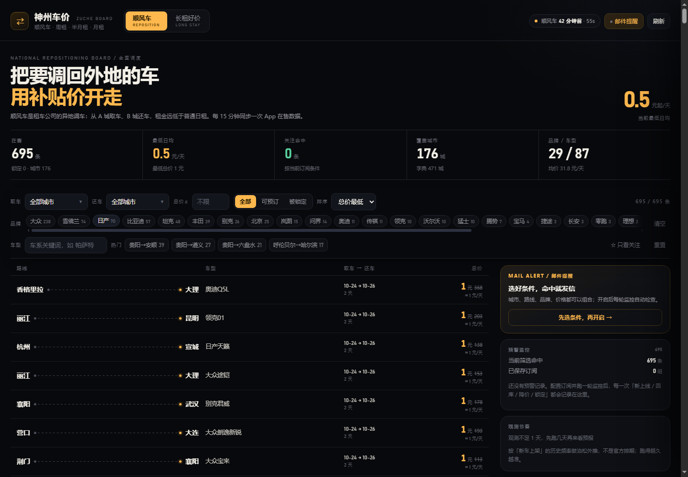

# 神州顺风车监控

盯「神州租车」App 里的**顺风车**（异地调车特价车）—— 车需要从一个城市调回另一个城市，你以 1 元 / 50 元 / 100 元的固定价把车开过去，租期 1～13 天。放出来基本靠抢，所以需要程序盯着。

程序做的事：**定时拉全量 → 比对生命周期（新上线 / 被锁定 / 回到订单库 / 过期剔除）→ 按条件过滤 → 发邮件等通知**，并把结果同步到一个可搜索的**可视面板**。

> 逆向过程、接口证据链见 [`docs/REVERSE_ENGINEERING.md`](docs/REVERSE_ENGINEERING.md)。
> 线上看板：<https://moodzzzz.github.io/shenzhou-hitch-monitor/>

---

## 它能告诉你什么

| 事件 | 含义 | 默认是否推送 |
|---|---|---|
| 🆕 **新上线** | 新放出来的顺风车 | 是 |
| ♻️ **回到订单库** | 之前被锁定/关闭的车，订单取消后又可预订了 | 是 |
| 🔒 **被锁定** | 车被别人下单锁定了，从可订池里消失 | 是 |
| ⬇️ **降价** | 同一条 `hitchId` 价格下调 | 是 |
| ⌛ **已过期剔除** | 还车日期已过，从库里清掉 | 否（只计数） |
| 🧹 **已关闭剔除** | 工单已不存在 | 否（只计数） |

> 「被锁定」不是猜的：列表接口只返回可预订的车，某条消失后程序会**按这条线路定向复查**，仍查不到才判定不可订；而且要**连续两轮**都查不到才推送，避免翻页抖动造成的误报。

---

## 特点

| | |
|---|---|
| 零第三方依赖 | 纯 Python 标准库，云端不用 `pip install` |
| 免登录 | 列表/详情/城市字典都不需要账号、Cookie 或签名 |
| 全国覆盖 | 5 个请求拿全 950+ 条（`pageSize=200`） |
| 只推增量 | 按 `hitchId` 落库，新上线性推送；同一条降价也提示 |
| 抗漏抓 | 全量翻页遇到数据位移会自动补一遍；消失的车再按线路复核 |
| 首轮不刷屏 | 首次运行只建基线，不把 900+ 条历史当「新上线」 |
| 邮件优先 | HTML 邮件，卡片式排版，手机上也好看 |
| 可视面板 | 搜车型 / 城市、看价格、看「指定地点」的上新预报 |

---

## 5 分钟上手

```bash
python main.py init                      # 生成配置
python main.py once --dry-run            # 演练：看当前能命中什么（不推送、不写状态）
python main.py test-notify               # 测通知渠道

python main.py once                      # 建立基线（首轮只记录，不推送）
python main.py watch                     # 常驻，默认 4 小时一轮
```

看板：

```bash
python main.py serve --refresh           # 抓一轮 + 起本地看板 → http://127.0.0.1:8765/
```

查城市 ID、导出 CSV：

```bash
python main.py cities 成都
python main.py snapshot
```

---

## 可视面板



面板是一个**静态页 + 一份 JSON**，所以两种用法都行：

- 本地：`python main.py serve --refresh`（或 `once --export dashboard/dashboard.json` 后起任意静态服务）
- 线上：GitHub Actions 每轮会把 `dashboard/dashboard.json` 提交回仓库并发布到 Pages

功能：

- **按车型搜索**：输入「宝马 / 理想 / 帕萨特」，实时过滤
- **按地点筛选**：取车城市、还车城市、价格上限
- **状态筛选**：全部 / 可预订 / 被锁定（被锁定的卡片是虚线 + 粉色徽标）
- **指定地点预报**：选一个取车城市，给出
  - 明天至少出现 1 条的概率（泊松分布 `P(X≥1)=1-e^(-λ)`）
  - 历史到达条数、日均上新、未来 7 天期望
  - 按星期的到达分布
- **观测节奏**：每天新增多少条，跑得越久越准

> 预报是**统计外推**，不是官方排期。刚跑第一天观测不足 1 天，会明确提示“观测不足”，不会编数。

---

## 配置说明

`config.json`（`python main.py init` 生成）。

### `watch` —— 推什么

全部为「与」关系；列表内部是「或」；留空表示不限制。

| 字段 | 说明 |
|---|---|
| `pickup_cities` | 取车城市，如 `["成都","重庆"]`；「成都」「成都市」都能匹配 |
| `return_cities` | 还车城市 |
| `routes` | 精确路线，如 `["成都→丽江"]` |
| `models` / `exclude_models` | 车型关键词白名单/黑名单 |
| `only_special` / `special_price` | 只推特价，默认 ≤100 元 |
| `max_price` / `min_price` | 总价区间 |
| `max_price_per_day` | 日均价上限 |
| `min_days` / `max_days` | 租期天数 |
| `date_from` / `date_to` | 取车日期窗口 |

```json
"watch": {
  "pickup_cities": ["成都"],
  "max_price": 100,
  "max_price_per_day": 60,
  "exclude_models": ["大众"]
}
```

### `behavior` —— 怎么推

| 字段 | 默认 | 说明 |
|---|---|---|
| `first_run` | `silent` | 首轮只建基线；改 `notify` 会把存量全推一遍 |
| `notify_new` | `true` | 推新上线 |
| `notify_relisted` | `true` | 推「回到订单库」 |
| `notify_locked` | `true` | 推「被锁定」 |
| `notify_price_drop` | `true` | 推降价 |
| `notify_expired` / `notify_closed` | `false` | 过期/关闭一般只计数，避免噪音 |
| `verify_missing` | `true` | 消失后按线路定向复查 |
| `verify_missing_limit` | `40` | 每轮最多复查多少条（控制请求量） |
| `confirm_absence_passes` | `2` | 连续几轮查不到才判定锁定 |
| `prune_expired_days` | `7` | 过期/关闭记录保留几天后硬删除 |
| `enrich_detail` | `true` | 命中后补详情拿原价、门店 |
| `detail_limit` | `10` | 每轮最多补几条事件详情 |
| `dashboard_enrich_limit` | `40` | 每轮为面板缓存几条原价（渐进覆盖，4 小时一轮约 4 天补全） |
| `max_items_per_message` | `8` | 单条消息最多列几条 |

### `poll` —— 多久拉一次

| 字段 | 默认 | 说明 |
|---|---|---|
| `interval_seconds` | `14400` | 轮询间隔，默认 4 小时，最小 120 秒 |
| `page_size` | `200` | 单页条数，上限 200 |
| `min_request_interval` | `1.2` | 请求间隔，自我限速 |

---

## 通知渠道

只填你想用的，其余留空。**密钥走环境变量**，不要提交到仓库。

| 渠道 | 配置 | 环境变量 |
|---|---|---|
| **邮件** | `notify.smtp` | `SZHITCH_SMTP_HOST` / `_PORT` / `_USER` / `_PASS` / `_TO` |
| 企业微信群机器人 | `notify.wecom_webhook` | `SZHITCH_WECOM` |
| 飞书 | `notify.feishu_webhook` + `feishu_secret` | `SZHITCH_FEISHU` |
| 钉钉 | `notify.dingtalk_webhook` + `dingtalk_secret` | `SZHITCH_DINGTALK` |
| Bark（iOS） | `notify.bark_key` | `SZHITCH_BARK` |
| Server酱 | `notify.serverchan_key` | `SZHITCH_SERVERCHAN` |
| 通用 Webhook | `notify.webhook_url` | `SZHITCH_WEBHOOK` |

### 邮件怎么配

以 QQ 邮箱为例（163、Gmail、Outlook 同理，用 **SMTP 授权码**，不是登录密码）：

```bash
export SZHITCH_SMTP_HOST=smtp.qq.com
export SZHITCH_SMTP_PORT=465
export SZHITCH_SMTP_USER=you@qq.com
export SZHITCH_SMTP_PASS=你的16位授权码
export SZHITCH_SMTP_TO=you@qq.com,other@example.com
python main.py test-notify
```

或直接写进 `config.json`：

```json
"notify": {
  "smtp": {
    "host": "smtp.qq.com",
    "port": 465,
    "user": "you@qq.com",
    "password": "授权码",
    "to": ["you@qq.com"],
    "ssl": true
  }
}
```

邮件是 HTML 卡片版：每条车一张卡，含路线、车型、现价/原价、「省 99%」、日期、门店。同一封邮件按「新上线 / 回到订单库 / 被锁定」分节。

---

## 部署

### GitHub Actions（推荐，零成本）

1. 建一个**公开**仓库（Free 套餐的 Pages 只支持公开仓库），把本目录推上去
2. **Settings → Secrets and variables → Actions** 添加邮件等密钥（见上表）
3. **Settings → Pages → Source** 选 `GitHub Actions`
4. 启用 Actions，手动跑一次（首次是建基线）

之后每 4 小时自动跑：抓取 → 发通知 → 提交 `dashboard/dashboard.json` → 发布 Pages。
面板地址形如 `https://<用户名>.github.io/<仓库名>/`。

> 仓库是公开的，所以**密钥只能放 Secrets**。配置里留空即可，工作流里有一道检查，
> 一旦发现 `config.json` 出现明文 webhook/密码会直接失败并报错。

> GitHub 的 cron 用 UTC，且高峰期可能延迟数分钟到十几分钟。要更准就用云函数。

### 本机 / VPS 常驻

```bash
python main.py watch
```

```bash
sudo cp -r . /opt/shenzhou-hitch-monitor
sudo cp deploy/systemd/szhitch.service /etc/systemd/system/
sudo systemctl enable --now szhitch
journalctl -u szhitch -f
```

### Docker

```bash
docker build -t szhitch .
docker run -d --name szhitch --restart always \
  -e SZHITCH_SMTP_HOST=smtp.qq.com -e SZHITCH_SMTP_USER=you@qq.com \
  -e SZHITCH_SMTP_PASS=授权码 -e SZHITCH_SMTP_TO=you@qq.com \
  -p 8765:8765 \
  -v $(pwd)/config.json:/app/config.json -v $(pwd)/data:/app/data \
  szhitch
```

### 阿里云函数计算 / 腾讯云 SCF

处理程序分别填 `cloud.aliyun_fc.handler.handler` 与 `cloud.tencent_scf.main_handler.main_handler`，定时触发器建议 4 小时一次。
函数实例无状态，**必须**外接存储放状态：`SZHITCH_STATE=oss://bucket/szhitch/state.json` + `OSS_*` 环境变量，否则每轮都会重复推送。

---

## 常见问题

**Q：面板说「被锁定」，但 App 里明明还能订？**
这是全量翻页的漏抓导致的误判。现已修复：消失的车会按「取车城市 + 还车城市」定向复查，查得到就撤销判定并记 `[纠正]` 日志；而且要连续两轮查不到才推送。历史遗留的误判可手动修：

```bash
python main.py recheck --dry-run   # 先看
python main.py recheck             # 写回
```

**Q：为什么第一次正式运行没有推送？**
首轮只建基线，否则 950+ 条会刷屏，之后也分不清哪些是真新出现。想看效果用 `--dry-run`。

**Q：面板上的「预报」准吗？**
它是基于历史上新频率的泊松外推，不是官方排期。观测天数越多越可信；不足 1 天会直接提示数据不足。

**Q：推送里的「原价 3048」是什么？**
顺风车本质是异地调车，`estTotalPrice` 是按日租算的正常价，`realTotalPrice` 是调车补贴价。

**Q：会被封吗？**
列表接口不需要账号。默认每 1.2 秒一个请求、4 小时一轮（约 6 轮/天、合计 300 请求/天以内），实测无风控。接口无公开文档，随时可能变。

---

## 目录结构

```
shenzhou-hitch-monitor/
├── main.py                 CLI：once / watch / serve / recheck / snapshot / cities
├── szhitch/
│   ├── gateway.py          网关客户端 + 抗漏抓翻页
│   ├── models.py           HitchItem 数据模型
│   ├── rules.py            筛选规则
│   ├── store.py            状态机 + 到达日志（SQLite / JSON / OSS）
│   ├── monitor.py          生命周期判定、文案、邮件 HTML
│   ├── insights.py         面板数据 + 预报
│   ├── notify.py           邮件/企微/飞书/钉钉/Bark/Server酱
│   └── config.py           配置加载
├── dashboard/              静态看板（index.html + dashboard.json）
├── cloud/                  云函数入口
├── deploy/systemd/         systemd unit
├── data/cities.json        471 个城市字典
├── docs/                   逆向报告 + 面板截图
└── tests/                  25 项离线测试（无需联网）
```

```bash
python -m unittest discover -s tests -v
```

---

## 合规提醒

- 只读取**公开可见**的在售列表，不涉及登录、下单、账号数据。
- 仅用于个人比价/盯盘，请勿转售数据或用于商业用途。
- 保持克制的请求频率；接口属于对方资产，滥用可能违反服务条款。
- 库存、价格、规则以 App 内实际展示为准。
